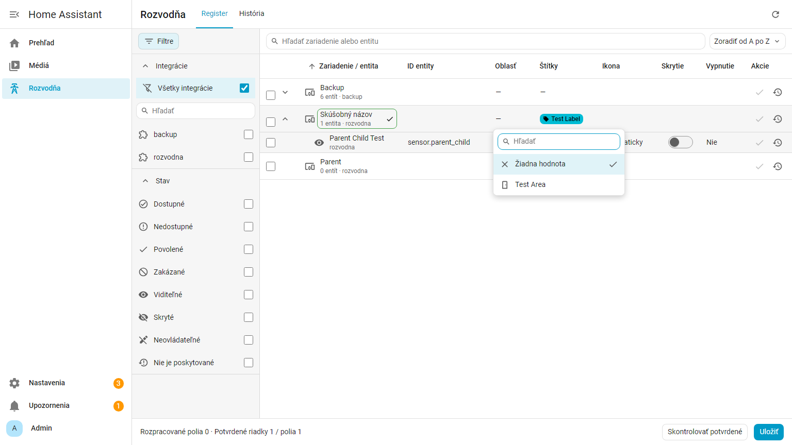
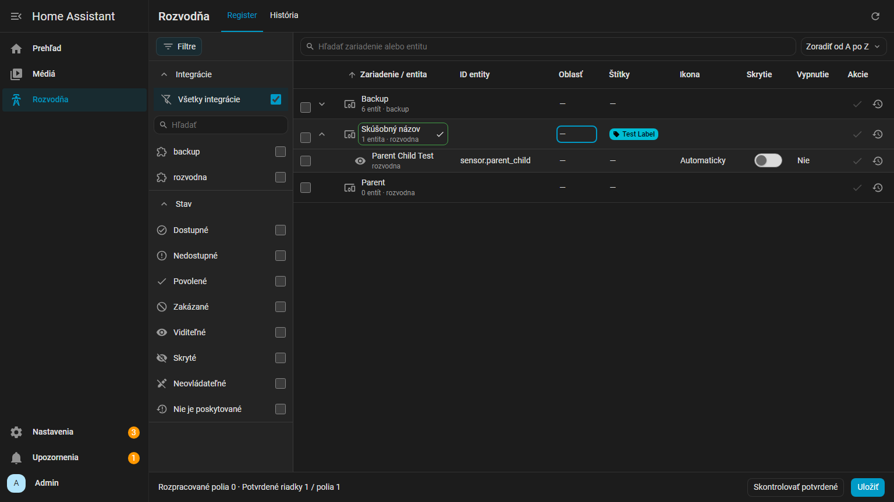
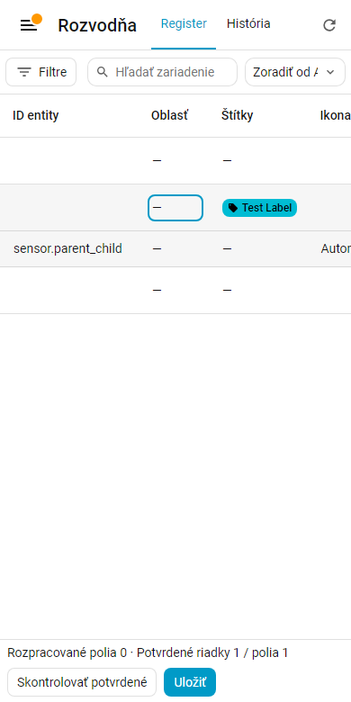
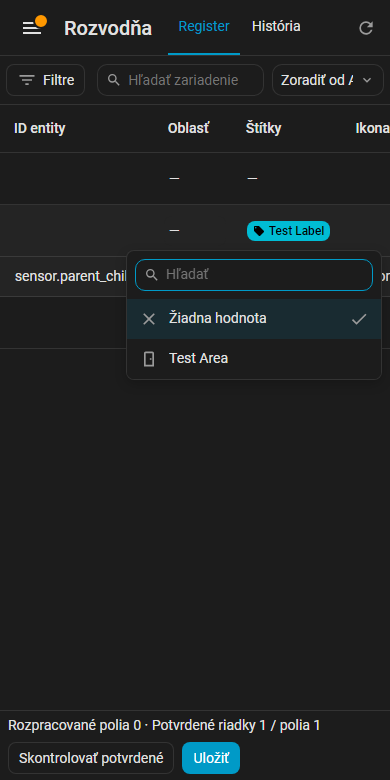

# Rozvodňa

Administračný panel na prehľadávanie a úpravu registrov Home Assistanta.
Zariadenia a entity sú v jednej tabuľke. Každý riadok sa potvrdzuje zvlášť
a globálne **Uložiť** zapíše potvrdené návrhy zo všetkých integrácií.

**Verzia 0.1.0 · Home Assistant Core 2026.11 · MIT**

Náhľad panelu zobrazuje syntetické testovacie záznamy.

Ďalšie náhľady: tmavý režim a úzka obrazovka

## Inštalácia cez Marketplace

1. V Home Assistante 2026.11 alebo novšom otvor **Nastavenia → Marketplace**.
2. Vyber **Pridať z odkazu** a vlož `https://github.com/denkz0ne/ha-rozvodna`.
   Pri prvom pridaní vlastného repozitára Marketplace požiada o prepojenie s GitHubom.
3. Nainštaluj **Rozvodňu**. Po reštarte pridaj integráciu cez
   **Nastavenia → Zariadenia a služby → Pridať integráciu**.
4. Otvor **Rozvodňa** v bočnom menu. Inštancia integrácie nemá parametre.

[Dokumentácia Marketplace](https://www.home-assistant.io/integrations/marketplace/#custom-repositories)

Pri ručnej inštalácii skopíruj celý priečinok `custom_components/rozvodna`
do `<config>/custom_components/` a pokračuj reštartom a pridaním integrácie.

## Práca s registrom

1. Textové vyhľadávanie ignoruje veľkosť písmen aj diakritiku. Hľadá v názvoch,
   ID entít, integráciách, oblastiach, štítkoch a názvoch konfiguračných položiek.
   V bočnom paneli môžeš zaškrtnúť viac integrácií a filtrovať stav entít.
   Vybrané filtre sa kombinujú s textovým vyhľadávaním.
2. V prvom stĺpci kliknutím na názov otvoríš jeho editor. Ikona entity otvorí
   natívne okno **Viac informácií** a ikona zariadenia otvorí jeho stránku v novej karte na pozadí.
   Pod názvom zariadenia je počet entít. Oblasti a štítky vyberáš v ponuke
   nad tabuľkou; už vybrané štítky sú v ponuke hore.
3. Enter prejde na ďalšie pole, Tab na susedné pole a Shift otočí smer.
   Esc ukončí editáciu. Kliknutie mimo otvoreného editora ho najprv dokončí;
   druhý klik aktivuje cieľové pole.
4. Oranžový návrh potvrď fajkou na konci daného riadka. Zelené návrhy
   prežijú obnovenie stránky a nájdeš ich cez **Skontrolovať potvrdené**.
5. Prepínač **Skrytie** mení viditeľnosť rovnako ako natívny prepínač
   Home Assistanta. Stav spravovaný integráciou zostane iba na čítanie.
6. **Uložiť** overí a zapíše potvrdené návrhy. Zmenu ID entity musíš
   potvrdiť samostatne. Odkazy v YAML, šablónach a kartách skontroluj
   podľa použitých ID.
7. V **Histórii** otvor detail zápisu. **Pripraviť návrat** vloží opačné
   hodnoty medzi potvrdené návrhy. Môžeš vybrať aj jednotlivé položky.
8. Pri konflikte obnov register, skontroluj detail a zruš alebo uprav
   kolidujúci návrh. Konflikt sa pri ukladaní neprepisuje automaticky.

Tabuľka zobrazuje všetky zodpovedajúce záznamy v jednom zozname bez stránkovania.
Pri tisícoch záznamov môže úplné vykreslenie spotrebovať viac pamäte prehliadača.

Hromadné úpravy otvor po označení riadkov. Náhľad podporuje oblasť, štítky
a úpravy názvov. Po prenesení náhľadu do tabuľky potvrď dotknuté riadky.

Pri odstránení integrácie zmizne panel. SQLite história a staging zostanú
v priečinku `<config>/rozvodna` pre prípad opätovného pridania.

[Architektúra](docs/ARCHITECTURE.md) · [Špecifikácia](docs/SPECIFICATION.md) ·
[API](docs/API.md) · [Databáza](docs/DATABASE.md) · [Vývoj](docs/DEVELOPMENT.md) ·
[Roadmapa](docs/ROADMAP.md)
